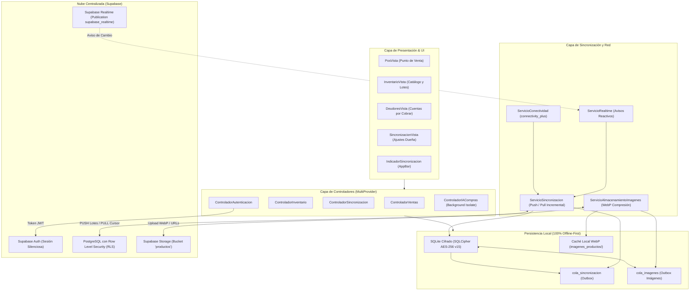

# Planteapp (Biznaga Kíix) 🌱

Sistema integral de **Punto de Venta (POS)**, **Gestión de Inventario Botánico** y **Respaldo Multi-Dispositivo en la Nube**, diseñado a medida para el vivero botánico **Biznaga Kíix**.

Desarrollado en **Flutter** bajo una estricta arquitectura **100% Offline-First**, garantizando que las operaciones de cobro, inventario y catálogo continúen funcionando con total fluidez sin importar la presencia o calidad de la conexión a internet.

---

## 📑 Tabla de Contenidos
1. [Filosofía Offline-First y Respaldo Cloud](#-filosofía-offline-first-y-respaldo-cloud)
2. [Arquitectura del Sistema](#-arquitectura-del-sistema)
3. [Funcionalidades Principales](#-funcionalidades-principales)
4. [Seguridad y Control de Acceso (RBAC)](#-seguridad-y-control-de-acceso-rbac)
5. [Capa de Sincronización y Supabase Cloud](#-capa-de-sincronización-y-supabase-cloud)
6. [Resumen de Cambios Recientes (Fases 0 a 8)](#-resumen-de-cambios-recientes-fases-0-a-8)
7. [Requisitos del Sistema](#-requisitos-del-sistema)
8. [Instalación y Puesta en Marcha](#-instalación-y-puesta-en-marcha)
9. [Batería de Pruebas y Calidad](#-batería-de-pruebas-y-calidad)
10. [Estructura del Proyecto](#-estructura-del-proyecto)

---

## 🌿 Filosofía Offline-First y Respaldo Cloud

Planteapp no depende de la nube para operar:
- **Fuente de verdad local:** Cada dispositivo escribe y lee en una base de datos local SQLite cifrada con **SQLCipher AES-256**. La aplicación nunca bloquea una venta ni la navegación esperando una respuesta de red.
- **Sincronización incremental bidireccional:** Al detectar conexión mediante `connectivity_plus`, un motor en segundo plano procesa la cola de salida (*outbox*) enviando mutaciones locales y descargando cambios remotos mediante cursor temporal (*Pull Incremental* con resolución *Last-Write-Wins*).
- **Modo Local Puro:** Si no se suministran credenciales de Supabase en tiempo de compilación, la app se inicializa automáticamente en Modo Local Puro sin degradación de interfaz ni advertencias molestas.
- **Inventario Inmune a Condiciones de Carrera:** El stock se calcula mediante un modelo **append-only** en la tabla `movimientos_inventario`, impidiendo que ventas simultáneas en distintas terminales sobreescriban existencias erróneamente.

---

## 🏗 Arquitectura del Sistema

El proyecto sigue los principios de **Clean Layered Architecture** y el patrón **MVVM reactivo** implementado con `MultiProvider` y `ChangeNotifier`:



---

## 🚀 Funcionalidades Principales

### 🛒 1. Punto de Venta (POS)
- Escaneo rápido de códigos de barras (mediante cámara integrada y soporte de lectores físicos).
- Carrito de compras reactivo con modificación de cantidades y aplicación de descuentos.
- Múltiples métodos de pago: Efectivo (con cálculo automático de cambio), Tarjeta y Transferencia bancaria.
- Cálculo de IVA y desglose transparente derivado en tiempo real.

### 📦 2. Control de Inventario Botánico
- Catálogo de productos organizado por categorías botánicas (plantas, macetas, insumos, sustratos).
- Historial atómico de movimientos de inventario (`movimientos_inventario`) para altas, bajas, ajustes y ventas.
- Detección reactiva de existencias críticas con Bottom Sheet interactivo de alertas.

### 💰 3. Cuentas por Cobrar (Deudores)
- Registro y control de ventas a crédito.
- Historial detallado de abonos por cliente con cálculo automático de saldos pendientes.

### 🖨 4. Emisión de Tickets e Impresión
- Generación de comprobantes y tickets en formato PDF.
- Soporte para impresión térmica móvil directa por Bluetooth (impresoras compatibles con ESC/POS).

### 🤖 5. Motor de Recomendación IA
- Análisis de rotación de inventario y sugerencias inteligentes de reabastecimiento botánico.
- Procesamiento en segundo plano mediante `Isolate.run` para evitar caídas de fotogramas en la interfaz.

### 🖼 6. Gestión y Compresión de Imágenes
- Compresión en el dispositivo móvil antes de guardar o transferir:
  - **Imagen principal:** WebP optimizado a máximo 1000px y 80% de calidad.
  - **Miniatura:** WebP a 300px y 75% de calidad para carga instantánea en listados.
- Caché local en disco en `imagenes_productos/` para visualización fluida a 60 FPS sin gastar datos móviles.
- Widget unificado `ImagenProductoWidget` con fallback a ilustraciones vectoriales SVG botánicas.

---

## 🔒 Seguridad y Control de Acceso (RBAC)

El sistema opera bajo un modelo estricto de **dos roles**:

| Rol | Permisos en la App | Políticas en Supabase (RLS) |
| :--- | :--- | :--- |
| **Dueño (`dueno`)** | Acceso total: POS, inventario, costos, reportes de ganancias, colaboradores, catálogo y configuración de sincronización. | `ALL` sobre las 7 tablas de negocio; escritura y eliminación en Storage. |
| **Empleado (`empleado`)** | Operativo: POS, registro de abonos y consulta básica de existencias y precios al público. Bloqueo de costos, métricas y usuarios. | `INSERT` en ventas/artículos/abonos; `SELECT` en productos (precios de venta únicamente); denegado en costos y colaboradores. |

- **Criptografía de Contraseñas:** Hash PBKDF2-HMAC-SHA256 con 100,000 iteraciones y salt único por usuario.
- **Almacenamiento Seguro de Llaves:** `flutter_secure_storage` respaldado por Android Keystore y Apple Keychain.
- **Protección de Base de Datos:** Cifrado completo en reposo mediante **SQLCipher AES-256**.
- **Cero Secretos Filtrados:** Cero presencia de llaves privilegiadas (`service_role`) en el cliente o historial.

---

## ☁️ Capa de Sincronización y Supabase Cloud

- **Indicador de Sincronización en AppBar (`IndicadorSincronizacion`):**
  - 🟢 **Sincronizado:** Base de datos al día con el servidor.
  - 🔵 **Pendiente:** Muestra badge con el número de cambios encolados en outbox.
  - 🔄 **Sincronizando:** Animación no bloqueante de intercambio de datos.
  - ⚪ **Sin Conexión:** Operación 100% offline normalizada.
  - 🟠 **Error:** Notificación con opción de reintento.
- **Pantalla de Administración (`SincronizacionVista`):**
  - Interruptor para pausar/reanudar sincronización automática.
  - Botón "Sincronizar Ahora" con debounce.
  - Diagnóstico de identificador de terminal (`dispositivo_id`), versión de base local (SQLite v15 Cifrado) y estado remoto.
  - Visor interactivo de la cola de errores y reintentos.
- **Supabase Realtime:**
  - Suscripción a avisos de cambios remotos en las 7 tablas de negocio.
  - El evento Realtime no muta la base directamente, sino que desencadena un *PULL* incremental ordenado para preservar una única ruta de escritura transaccional.
  - Pausa inteligente en segundo plano para ahorrar batería y datos.

---

## 📜 Resumen de Cambios Recientes (Fases 0 a 8)

Durante el ciclo de integración de la rama `feature/supabase` (Certificado el 17 de Noviembre de 2026), se llevaron a cabo los siguientes hitos:

- **Fase 0: Auditoría Previa del Código:** Diagnóstico estructural de las 14 versiones previas del esquema SQLite, inventario y seguridad.
- **Fase 1: Infraestructura en Supabase:** Creación de las 7 tablas en Postgres con Row Level Security (RLS), bucket `productos` en Storage y publicación `supabase_realtime`.
- **Fase 2: Migración a SQLite v15:** Respaldo previo `.pre_v15.bak`, migración con columnas de sincronización (`uuid`, `updated_at`, `deleted_at`, `sync_estado`, `dispositivo_id`), desacople a `movimientos_inventario` append-only y tablas outbox.
- **Fase 3: Motor de Sincronización Offline-First:** Implementación de `ServicioSincronizacion` con PUSH estructurado por grafo de dependencias y PULL incremental por cursor temporal.
- **Fase 4 & 4b: Autenticación, Roles y Realtime:** Sesión silenciosa con Supabase Auth, validación RLS y servicio `ServicioRealtime` con control de ciclo de vida.
- **Fase 5: Experiencia de Usuario Mínima:** Creación de `IndicadorSincronizacion` en cabeceras y `SincronizacionVista` en Ajustes (exclusiva para la Dueña).
- **Fase 6: Almacenamiento de Imágenes:** Compresión dual WebP nativa, cola de subida offline `cola_imagenes`, caché en disco a 60 FPS y políticas en Storage.
- **Fase 7 & 8: Certificación de Calidad y Cierre:**
  - **163 / 163 pruebas automatizadas pasando con 0 errores.**
  - Elaboración de la guía de pruebas manuales y checklist de seguridad.

---

## 💻 Requisitos del Sistema

- **Flutter SDK:** 3.24.0 o superior (compatible con Flutter 3.47+ / Dart 3.13+).
- **Android:** Android 8.0 (API nivel 26) o superior.
- **iOS:** iOS 13.0 o superior.
- **Herramientas de Desarrollo:** VS Code o Android Studio con extensiones de Flutter y Dart.

---

## 🛠 Instalación y Puesta en Marcha

### 1. Clonar el repositorio y acceder a la carpeta de la app
```bash
git clone https://github.com/tu-usuario/PLANTEAPP.git
cd PLANTEAPP/mi_app
```

### 2. Instalar dependencias
```bash
flutter pub get
```

### 3. Ejecutar la aplicación

#### Opción A: Modo Local Puro (100% Offline, sin configuración de servidor)
Ideal para desarrollo local o terminales independientes:
```bash
flutter run
```

#### Opción B: Con Sincronización en la Nube (Supabase)
Pasa las variables de entorno de forma segura mediante `--dart-define`:
```bash
flutter run \
  --dart-define=SUPABASE_URL=https://tu-proyecto.supabase.co \
  --dart-define=SUPABASE_ANON_KEY=tu-anon-key-publica
```

### 4. Compilación para Producción (Release)

#### Generar APK (Android)
```bash
flutter build apk --release \
  --dart-define=SUPABASE_URL=https://tu-proyecto.supabase.co \
  --dart-define=SUPABASE_ANON_KEY=tu-anon-key-publica
```
*Ubicación del binario:* `build/app/outputs/flutter-apk/app-release.apk`

#### Generar App Bundle para Google Play (AAB)
```bash
flutter build appbundle --release \
  --dart-define=SUPABASE_URL=https://tu-proyecto.supabase.co \
  --dart-define=SUPABASE_ANON_KEY=tu-anon-key-publica
```

---

## 🧪 Batería de Pruebas y Calidad

Para ejecutar la suite completa de pruebas unitarias y de widgets:

```bash
cd mi_app
flutter test
```

### Cobertura de la Suite (163 Pruebas Automatizadas):
- `test/widget_test.dart`: Pruebas de integración de componentes visuales y flujos core.
- `test/motor_ia_test.dart`: Validación del algoritmo y procesamiento en Isolate del motor de IA.
- `test/migracion_v15_test.dart`: Verificación de actualización de SQLite v14 a v15 y respaldo de seguridad.
- `test/sincronizacion_test.dart`: Pruebas del motor Push/Pull incremental, resolución LWW y outbox.
- `test/autenticacion_roles_rls_test.dart`: Validación de PBKDF2 local, sesión silenciosa y matriz de roles.
- `test/realtime_test.dart`: Recepción de avisos remotos, reconexión y ciclo de vida en segundo plano.
- `test/ui_sincronizacion_test.dart`: Estados visuales del indicador y protección RBAC en la pantalla de respaldo.
- `test/imagenes_storage_test.dart`: Compresión WebP, caché local y encolamiento offline de imágenes.

---

## 📁 Estructura del Proyecto

```text
PLANTEAPP/
├── Bitacora.md                           # Registro de avance cronológico de desarrollo
├── docs/                                 # Documentación técnica y especificaciones
│   ├── contexto_general_planteapp.md     # Documento de arquitectura detallado
│   ├── informe_integracion_supabase.md   # Informe ejecutivo de certificación
│   ├── guia_pruebas_manuales_fase7.md    # Protocolo de pruebas en dispositivo físico
│   ├── supabase_esquema_inicial.sql      # DDL de PostgreSQL con RLS y Storage
│   └── verificacion_rls_fase4.sql        # Script de auditoría no destructiva RLS
└── mi_app/                               # Código fuente del proyecto Flutter
    ├── lib/
    │   ├── controladores/                # Gestores de estado (ChangeNotifier)
    │   ├── modelos/                      # Modelos de datos del negocio
    │   ├── servicios/                    # Capa de persistencia, red, storage y criptografía
    │   └── vistas/                       # Pantallas y widgets de usuario (POS, Inventario, Sync)
    ├── test/                             # 163 pruebas automatizadas
    └── pubspec.yaml                      # Manifiesto de paquetes y dependencias
```

---

## 📄 Licencia y Créditos
Desarrollado para **Biznaga Kíix**. Todos los derechos reservados © 2026.
